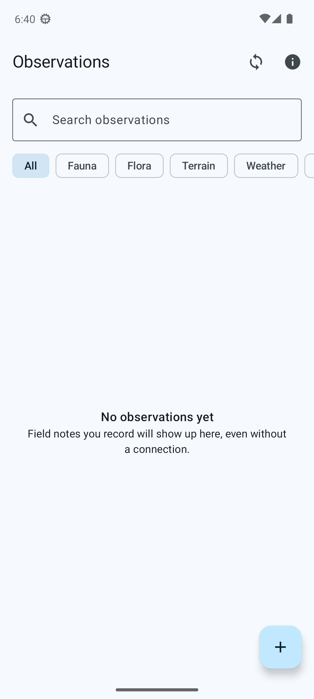
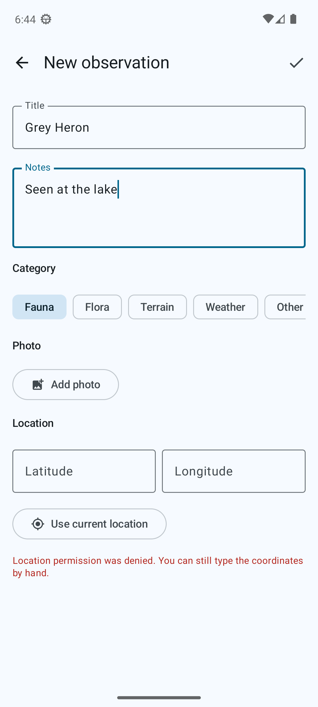
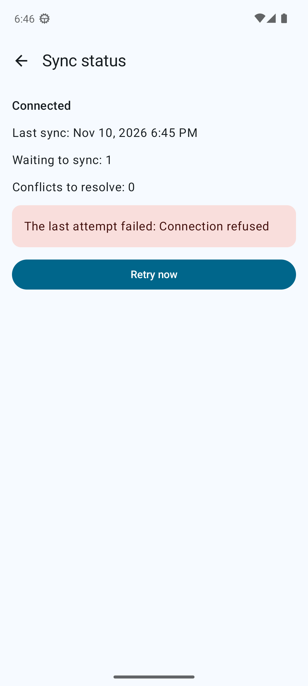
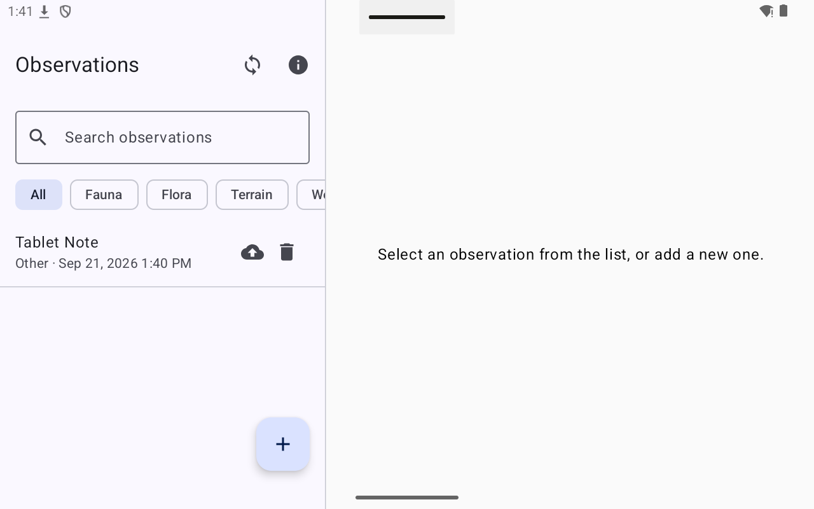
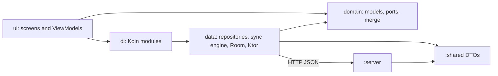
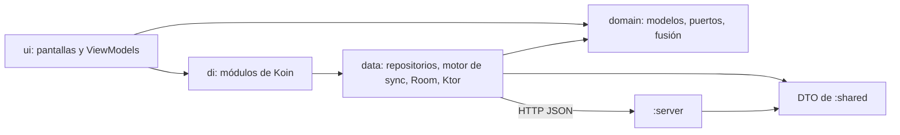
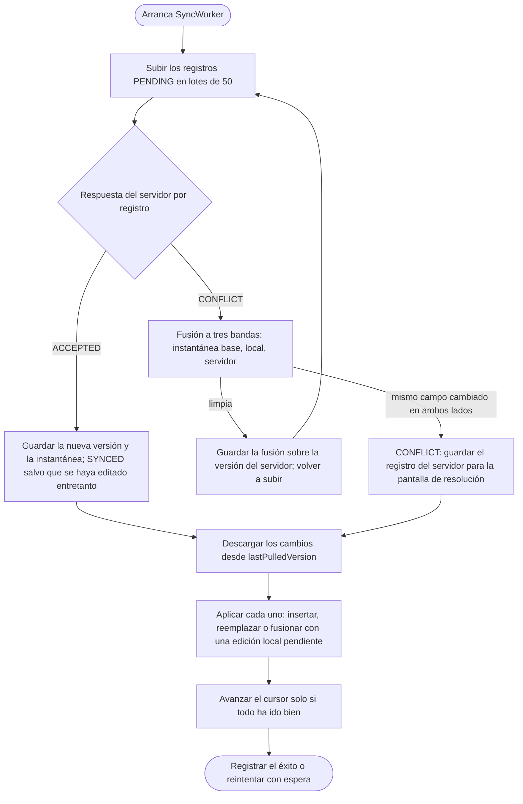

# Bitacora

[English](#english) · [Español](#español)

## English

An offline-first field diary for Android. Record observations (title, notes, category, photo, coordinates) with no connection at all; the local database is the source of truth. Changes are uploaded to a server when the network is back, changes made on other devices are downloaded, and edit conflicts are resolved field by field.

The point of the project is the synchronization: a change queue, retries with backoff, a three-way merge, a conflict screen and a visible sync state. Everything else is support.

100% Kotlin and Jetpack Compose (Material 3).

> **Status:** built, unit-tested (129 tests), linted (no errors) and exercised on an Android API 33 emulator (`portfolio_phone`) and a tablet emulator (`medium_tablet`) against the in-process server. See [Known limitations](#known-limitations) for what was not checked.

### Screenshots

| | |
|---|---|
|  |  |
| Empty state | A note created with the server down stays `PENDING` (cloud-upload icon) |
|  |  |
| Permission denied: manual entry still works | Sync status screen with the server down |

Two-pane layout on `medium_tablet` in landscape:



More in `docs/capturas/`: location filled from `adb emu geo fix`, the photo copy, and the sync status after recovery.

### Modules

| Module | What it is |
|---|---|
| `:app` | The Android app. |
| `:server` | Ktor (Netty) server with in-memory storage. It stands in for a real backend so the project needs no accounts. |
| `:shared` | Kotlin JVM module with the `kotlinx.serialization` DTOs used by app and server. |

### Build and run

Requirements: JDK 17 and the Android SDK (`compileSdk` 36). Create `local.properties` with your `sdk.dir`.

```bash
# Start the server (port 8080)
./gradlew :server:run

# Build, test and lint the app
./gradlew assembleDebug testDebugUnitTest :server:test lintDebug
```

On Windows use `.\gradlew.bat`. The emulator reaches the host at `http://10.0.2.2:8080`; the URL is `BuildConfig.SERVER_URL`. Cleartext HTTP is allowed only towards `10.0.2.2` and only in debug builds (`src/debug` network security config). To test on a real device, change `SERVER_URL` in `app/build.gradle.kts` to your machine's LAN address and add it to the debug network security config.

To set a location on the emulator: `adb emu geo fix <longitude> <latitude>`.

### Architecture

Layers per package: `domain` (models, ports, the merge), `data` (Room, network, sync, device services), `ui` (Compose screens and ViewModels), `di` (Koin modules). Each ViewModel exposes one immutable `StateFlow` of UI state.



#### Synchronization flow

A single `SyncWorker` (unique work, network-connected constraint, exponential backoff) runs the `SyncEngine`. It is triggered when a change is saved, when the network comes back, when the app opens, and by the manual button.


Protocol (server keeps a global version counter; every accepted write gets the next version):

- `GET /observations?since=<version>` returns the records with a greater version (deleted ones included) and the latest version.
- `POST /observations/batch` takes changes with a `baseVersion`. Each is `ACCEPTED` with its new version, or `CONFLICT` with the server's current record.

Merge rules (`domain/Merge.kt`, a pure function): per field, a value changed on one side only wins; the same change on both sides is not a conflict; different changes to the same field are a conflict that the user resolves per field. A deletion against an edit is not a conflict: the edit wins and the record is restored.

Uploads are idempotent. The server answers a replayed change that matches what it stored with the stored version, so an upload whose response was lost (for example the process was killed) can simply be repeated without duplicates or losses.

### Decisions

- **Local database as source of truth.** The UI only reads Room; sync writes to Room. The list works identically online and offline.
- **Soft delete.** Deletions are rows flagged `deleted` so they can be synced and undone. The cost is that tombstones are never purged.
- **Deletion against edit: the edit wins.** Losing someone's text because another device deleted the record seemed worse than resurrecting a deleted record. The user can delete it again.
- **Field-level merge instead of last-writer-wins.** Needs a stored base snapshot per record, but avoids silently discarding edits made to different fields.
- **Optimistic version check on the server.** A change is accepted if the server version is not newer than the change's `baseVersion`. Simple and enough for an in-memory server.
- **Conflict state keeps local content.** A record in `CONFLICT` still shows (and can still be edited with) the local version; the server record is stored beside it until the user chooses.
- **Rejected requests become `ERROR`, network failures stay `PENDING`.** A 4xx means retrying unchanged cannot help, so those records show their cause and wait for a manual retry. Timeouts and 5xx are transient and retried by backoff.
- **Photos are local only** and copied to internal storage from the system photo picker. A photo-only edit does not queue an upload.
- **Framework `LocationManager`** instead of Play Services, so the app needs no Google services. Permission denial and permanent denial both leave manual coordinate entry available.
- **Observation date is set at creation** and is not editable in the form; it is still synced and merged like any other field.
- **Two-pane layout from 600 dp wide** (`LocalConfiguration`), list on the left and editor on the right; below that, separate screens.
- **Koin instead of Hilt.** Koin 4.2.2 (with `koin-androidx-workmanager`) is a Kotlin-first DI library with no annotation processing. The same preference for Kotlin-first libraries applies to networking: the Ktor client uses the CIO engine, so there is no OkHttp or Retrofit. Library versions are listed in `VERSIONES.md`.
- **Few extra libraries.** Besides the core stack, only `kotlin-test` (ships with Kotlin), `logback` for server logging and `androidx.test:core-ktx` for Robolectric tests.

### Tests

Unit tests under `app/src/test` (JUnit 4, Robolectric for Room and WorkManager, Ktor `MockEngine`) and `server/src/test` (`testApplication`):

- DAO (Robolectric), repository, ViewModels, validation, coordinates parsing.
- The merge: no changes, local only, remote only, same change on both sides, different fields, same field (conflict), deletion against edit, and resolution.
- Sync engine against a scriptable fake remote: upload, batches, retries, rejected requests, edits during upload, pull with cursor, merges, conflicts, interrupted passes.
- `SyncWorker` through `TestListenableWorkerBuilder`; the Ktor client against `MockEngine`.
- Integration: two simulated devices with their own databases syncing through the real server application running in process (`SyncIntegrationTest`), including edits to different fields, the same field, deletion against edit, and an upload whose response is lost.

### Known limitations

- Verified on emulators only: the conflict resolution screen was exercised by unit and in-process integration tests, not by hand on a device; two real devices on a LAN were not tried. Killing the process during an upload (`am force-stop`) was done on the emulator and the app recovered without errors, but the no-duplicates guarantee is demonstrated by the idempotent-replay tests.
- The server keeps data in memory only; restarting it loses everything, and clients with a stored cursor then see an empty server. Not handled.
- No authentication or users; photos are never uploaded; no maps (all out of scope by design).
- Tombstones of deleted records are never purged.
- Search treats `%` and `_` as wildcards (SQL `LIKE` without escaping).
- Accessibility is basic: content descriptions, headings and live regions for banners, no custom TalkBack testing.
- Lint reports four warnings (`UseKtx`, `ObsoleteSdkInt`, `ConfigurationScreenWidthHeight`, `DataExtractionRules`), none of them errors.

---

## Español

Un diario de campo para Android que funciona sin conexión. Permite registrar observaciones (título, notas, categoría, foto y coordenadas) sin red, y la base de datos local es la fuente de verdad. Cuando vuelve la red, los cambios se suben a un servidor, se descargan los que se hicieron en otros dispositivos y los conflictos de edición se resuelven campo a campo.

Lo importante del proyecto es la sincronización: una cola de cambios, reintentos con espera exponencial, una fusión a tres bandas, una pantalla de conflictos y un estado de sincronización visible. Todo lo demás está al servicio de eso.

100 % Kotlin y Jetpack Compose (Material 3).

> **Estado:** compilada, con tests unitarios (129), lint sin errores y probada en un emulador Android API 33 (`portfolio_phone`) y en un emulador de tablet (`medium_tablet`) contra el servidor en local. Lo que no se ha comprobado está en [Limitaciones conocidas](#limitaciones-conocidas).

### Capturas

| | |
|---|---|
|  |  |
| Estado vacío | Una nota creada con el servidor caído se queda en `PENDING` (icono de subida a la nube) |
|  |  |
| Permiso denegado: la entrada manual sigue funcionando | Pantalla de estado de sincronización con el servidor caído |

Vista en dos paneles en `medium_tablet` en horizontal:


Hay más en `docs/capturas/`: la ubicación rellenada con `adb emu geo fix`, la copia de la foto y el estado de sincronización tras recuperarse.

### Módulos

| Módulo | Qué es |
|---|---|
| `:app` | La app Android. |
| `:server` | Servidor Ktor (Netty) con almacenamiento en memoria. Sustituye a un backend real para que el proyecto no necesite cuentas. |
| `:shared` | Módulo Kotlin JVM con los DTO de `kotlinx.serialization` que comparten la app y el servidor. |

### Compilar y ejecutar

Requisitos: JDK 17 y el Android SDK (`compileSdk` 36). Crea `local.properties` con tu `sdk.dir`.

```bash
# Arrancar el servidor (puerto 8080)
./gradlew :server:run

# Compilar, ejecutar los tests y pasar lint a la app
./gradlew assembleDebug testDebugUnitTest :server:test lintDebug
```

En Windows usa `.\gradlew.bat`. El emulador llega al PC en `http://10.0.2.2:8080`; la URL está en `BuildConfig.SERVER_URL`. El HTTP sin cifrar solo se permite hacia `10.0.2.2` y solo en las builds de depuración (configuración de seguridad de red en `src/debug`). Para probar en un dispositivo real, cambia `SERVER_URL` en `app/build.gradle.kts` por la dirección de tu equipo en la red local y añádela a esa configuración de depuración.

Para fijar una ubicación en el emulador: `adb emu geo fix <longitud> <latitud>`.

### Arquitectura

Capas por paquete: `domain` (modelos, puertos y la fusión), `data` (Room, red, sincronización y servicios del dispositivo), `ui` (pantallas Compose y ViewModels) y `di` (módulos de Koin). Cada ViewModel expone un único `StateFlow` inmutable con el estado de la pantalla.



#### Flujo de sincronización

Un único `SyncWorker` (trabajo único, restricción de red conectada y espera exponencial) ejecuta el `SyncEngine`. Se lanza al guardar un cambio, cuando vuelve la red, al abrir la app y con el botón manual.



Protocolo (el servidor lleva un contador de versión global; cada escritura aceptada recibe la siguiente versión):

- `GET /observations?since=<version>` devuelve los registros con una versión mayor (incluidos los borrados) y la última versión.
- `POST /observations/batch` recibe cambios con un `baseVersion`. Cada uno queda `ACCEPTED` con su nueva versión, o `CONFLICT` con el registro actual del servidor.

Reglas de fusión (`domain/Merge.kt`, una función pura): por campo, el valor que solo ha cambiado en un lado gana; el mismo cambio en ambos lados no es un conflicto; cambios distintos en el mismo campo son un conflicto que el usuario resuelve campo a campo. Un borrado frente a una edición no es un conflicto: gana la edición y el registro se restaura.

Las subidas son idempotentes. Si se reenvía un cambio que coincide con lo que el servidor ya guardó, este responde con la versión guardada, así que una subida cuya respuesta se perdió (por ejemplo, porque se mató el proceso) puede repetirse sin duplicados ni pérdidas.

### Decisiones

- **La base de datos local es la fuente de verdad.** La UI solo lee de Room y la sincronización escribe en Room. La lista funciona igual con y sin conexión.
- **Borrado lógico.** Los borrados son filas marcadas como `deleted`, para poder sincronizarlos y deshacerlos. A cambio, esas marcas nunca se purgan.
- **Borrado frente a edición: gana la edición.** Perder el texto de alguien porque otro dispositivo borró el registro parecía peor que resucitar un registro borrado. El usuario puede volver a borrarlo.
- **Fusión por campo en lugar de "gana la última escritura".** Exige guardar una instantánea base por registro, pero evita descartar en silencio ediciones hechas en campos distintos.
- **Comprobación optimista de versión en el servidor.** Un cambio se acepta si la versión del servidor no es más nueva que el `baseVersion` del cambio. Es simple y basta para un servidor en memoria.
- **El estado de conflicto conserva el contenido local.** Un registro en `CONFLICT` sigue mostrando (y permite editar) la versión local; el registro del servidor se guarda al lado hasta que el usuario elige.
- **Las peticiones rechazadas pasan a `ERROR`; los fallos de red se quedan en `PENDING`.** Un 4xx significa que reintentar sin cambios no sirve, así que esos registros muestran la causa y esperan un reintento manual. Los timeouts y los 5xx son transitorios y se reintentan con espera exponencial.
- **Las fotos son solo locales** y se copian al almacenamiento interno desde el selector de fotos del sistema. Una edición que solo cambia la foto no encola una subida.
- **`LocationManager` del framework** en lugar de Play Services, para que la app no dependa de los servicios de Google. Tanto si se deniega el permiso como si se deniega de forma permanente, se pueden seguir introduciendo las coordenadas a mano.
- **La fecha de la observación se fija al crearla** y no se puede editar en el formulario; aun así se sincroniza y se fusiona como cualquier otro campo.
- **Dos paneles a partir de 600 dp de ancho** (`LocalConfiguration`), con la lista a la izquierda y el editor a la derecha; por debajo, pantallas separadas.
- **Koin en lugar de Hilt.** Koin 4.2.2 (con `koin-androidx-workmanager`) es una librería de inyección de dependencias pensada para Kotlin y sin procesado de anotaciones. La misma preferencia por librerías de Kotlin se aplica a la red: el cliente Ktor usa el motor CIO, así que no hay OkHttp ni Retrofit. Las versiones de las librerías están en `VERSIONES.md`.
- **Pocas librerías extra.** Aparte de la base, solo `kotlin-test` (viene con Kotlin), `logback` para los logs del servidor y `androidx.test:core-ktx` para los tests con Robolectric.

### Pruebas

Tests unitarios en `app/src/test` (JUnit 4, Robolectric para Room y WorkManager, `MockEngine` de Ktor) y en `server/src/test` (`testApplication`):

- DAO (Robolectric), repositorio, ViewModels, validación y lectura de coordenadas.
- La fusión: sin cambios, solo local, solo remoto, el mismo cambio en ambos lados, campos distintos, el mismo campo (conflicto), borrado frente a edición y resolución.
- Motor de sincronización contra un remoto falso programable: subida, lotes, reintentos, peticiones rechazadas, ediciones durante la subida, descarga con cursor, fusiones, conflictos y pasadas interrumpidas.
- `SyncWorker` mediante `TestListenableWorkerBuilder`; el cliente Ktor contra `MockEngine`.
- Integración: dos dispositivos simulados, cada uno con su base de datos, sincronizando a través de la aplicación de servidor real ejecutándose en el mismo proceso (`SyncIntegrationTest`), con ediciones en campos distintos, en el mismo campo, borrado frente a edición y una subida cuya respuesta se pierde.

### Limitaciones conocidas

- Solo verificada en emuladores: la pantalla de resolución de conflictos se ha probado con tests unitarios y de integración en proceso, no a mano en un dispositivo; no se ha probado con dos dispositivos reales en una red local. Matar el proceso durante una subida (`am force-stop`) se hizo en el emulador y la app se recuperó sin errores, pero la garantía de que no hay duplicados la demuestran los tests de reenvío idempotente.
- El servidor guarda los datos solo en memoria; al reiniciarlo se pierde todo, y los clientes con un cursor guardado ven entonces un servidor vacío. No está resuelto.
- Sin autenticación ni usuarios; las fotos nunca se suben; sin mapas (todo fuera del alcance a propósito).
- Las marcas de los registros borrados nunca se purgan.
- La búsqueda trata `%` y `_` como comodines (SQL `LIKE` sin escapar).
- La accesibilidad es básica: descripciones de contenido, encabezados y regiones vivas para los avisos, sin pruebas específicas con TalkBack.
- Lint da cuatro avisos (`UseKtx`, `ObsoleteSdkInt`, `ConfigurationScreenWidthHeight`, `DataExtractionRules`), ninguno es un error.
