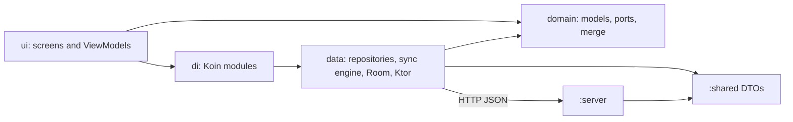
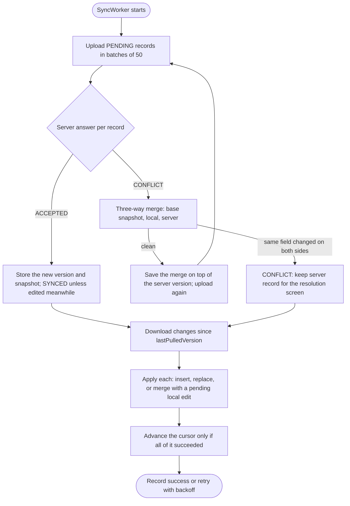

# Bitacora

An offline-first field diary for Android. Record observations (title, notes, category, photo, coordinates) with no connection at all; the local database is the source of truth. Changes are uploaded to a server when the network is back, changes made on other devices are downloaded, and edit conflicts are resolved field by field.

The point of the project is the synchronization: a change queue, retries with backoff, a three-way merge, a conflict screen and a visible sync state. Everything else is support.

100% Kotlin and Jetpack Compose (Material 3).

> **Status: written but never compiled or run.** Gradle could not start in the environment where this code was written, so none of it has been built, unit tested, linted or run on an emulator. See [Known limitations](#known-limitations).

## Screenshots

None yet. They have to be captured on an emulator, which was not possible. Planned location: `docs/capturas/`.

## Modules

| Module | What it is |
|---|---|
| `:app` | The Android app. |
| `:server` | Ktor (Netty) server with in-memory storage. It stands in for a real backend so the project needs no accounts. |
| `:shared` | Kotlin JVM module with the `kotlinx.serialization` DTOs used by app and server. |

## Build and run

Requirements: JDK 17 and the Android SDK (`compileSdk` 36). Create `local.properties` with your `sdk.dir`.

```bash
# Start the server (port 8080)
./gradlew :server:run

# Build, test and lint the app
./gradlew assembleDebug testDebugUnitTest :server:test lintDebug
```

On Windows use `.\gradlew.bat`. The emulator reaches the host at `http://10.0.2.2:8080`; the URL is `BuildConfig.SERVER_URL`. Cleartext HTTP is allowed only towards `10.0.2.2` and only in debug builds (`src/debug` network security config). To test on a real device, change `SERVER_URL` in `app/build.gradle.kts` to your machine's LAN address and add it to the debug network security config.

To set a location on the emulator: `adb emu geo fix <longitude> <latitude>`.

## Architecture

Layers per package: `domain` (models, ports, the merge), `data` (Room, network, sync, device services), `ui` (Compose screens and ViewModels), `di` (Koin modules). Each ViewModel exposes one immutable `StateFlow` of UI state.



### Synchronization flow

A single `SyncWorker` (unique work, network-connected constraint, exponential backoff) runs the `SyncEngine`. It is triggered when a change is saved, when the network comes back, when the app opens, and by the manual button.



Protocol (server keeps a global version counter; every accepted write gets the next version):

- `GET /observations?since=<version>` returns the records with a greater version (deleted ones included) and the latest version.
- `POST /observations/batch` takes changes with a `baseVersion`. Each is `ACCEPTED` with its new version, or `CONFLICT` with the server's current record.

Merge rules (`domain/Merge.kt`, a pure function): per field, a value changed on one side only wins; the same change on both sides is not a conflict; different changes to the same field are a conflict that the user resolves per field. A deletion against an edit is not a conflict: the edit wins and the record is restored.

Uploads are idempotent. The server answers a replayed change that matches what it stored with the stored version, so an upload whose response was lost (for example the process was killed) can simply be repeated without duplicates or losses.

## Decisions

- **Local database as source of truth.** The UI only reads Room; sync writes to Room. The list works identically online and offline.
- **Soft delete.** Deletions are rows flagged `deleted` so they can be synced and undone. The cost is that tombstones are never purged.
- **Deletion against edit: the edit wins.** Losing someone's text because another device deleted the record seemed worse than resurrecting a deleted record. The user can delete it again.
- **Field-level merge instead of last-writer-wins.** Needs a stored base snapshot per record, but avoids silently discarding edits made to different fields.
- **Optimistic version check on the server.** A change is accepted if the server version is not newer than the change's `baseVersion`. Simple and enough for an in-memory server.
- **Conflict state keeps local content.** A record in `CONFLICT` still shows (and can still be edited with) the local version; the server record is stored beside it until the user chooses.
- **Rejected requests become `ERROR`, network failures stay `PENDING`.** A 4xx means retrying unchanged cannot help, so those records show their cause and wait for a manual retry. Timeouts and 5xx are transient and retried by backoff.
- **Photos are local only** and copied to internal storage from the system photo picker. A photo-only edit does not queue an upload.
- **Framework `LocationManager`** instead of Play Services, as the guide asks. Permission denial and permanent denial both leave manual coordinate entry available.
- **Observation date is set at creation** and is not editable in the form; it is still synced and merged like any other field.
- **Two-pane layout from 600 dp wide** (`LocalConfiguration`), list on the left and editor on the right; below that, separate screens.
- **Koin for dependency injection.** The guide proposes Hilt, but the project was switched to Koin 4.2.2 (with `koin-androidx-workmanager`) while this code was being written, and that choice was kept. The Ktor client engine is CIO for the same reason. Neither version is in the guide's tables; see `VERSIONES.md`.
- **No new libraries beyond the guide**, except `kotlin-test` (ships with Kotlin), `logback` for server logging and `androidx.test:core-ktx` for Robolectric tests.

## Tests

Unit tests under `app/src/test` (JUnit 4, Robolectric for Room and WorkManager, Ktor `MockEngine`) and `server/src/test` (`testApplication`):

- DAO (Robolectric), repository, ViewModels, validation, coordinates parsing.
- The merge: no changes, local only, remote only, same change on both sides, different fields, same field (conflict), deletion against edit, and resolution.
- Sync engine against a scriptable fake remote: upload, batches, retries, rejected requests, edits during upload, pull with cursor, merges, conflicts, interrupted passes.
- `SyncWorker` through `TestListenableWorkerBuilder`; the Ktor client against `MockEngine`.
- Integration: two simulated devices with their own databases syncing through the real server application running in process (`SyncIntegrationTest`), including edits to different fields, the same field, deletion against edit, and an upload whose response is lost.

## Known limitations

- **Never compiled, tested, linted or run.** The Gradle client failed to start in the environment where this was written (`java.io.IOException: Unable to establish loopback connection`; see `BLOQUEOS.md`). All code was written by hand, reviewing imports, the versions in the project's version catalog and API signatures, but there may be compile errors, test failures or lint errors. Treat milestones 1 to 6 as "code written, not compiled or tested".
- No screenshots and nothing verified on an emulator or device (including the photo picker, the location permission flows, the two-pane layout on `medium_tablet`, and force-stopping the app during an upload).
- The server keeps data in memory only; restarting it loses everything, and clients with a stored cursor then see an empty server. Not handled.
- No authentication or users; photos are never uploaded; no maps (all out of scope by design).
- Tombstones of deleted records are never purged.
- Search treats `%` and `_` as wildcards (SQL `LIKE` without escaping).
- Accessibility is basic: content descriptions, headings and live regions for banners, no custom TalkBack testing.
- Dependency versions marked as suggested in the project guide (Koin, Work, DataStore, serialization) were not resolved against a repository from this machine.
