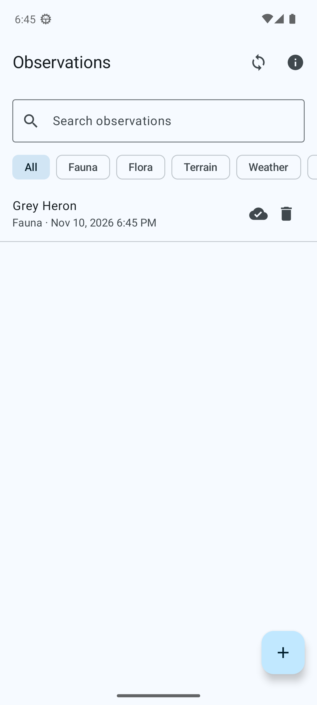
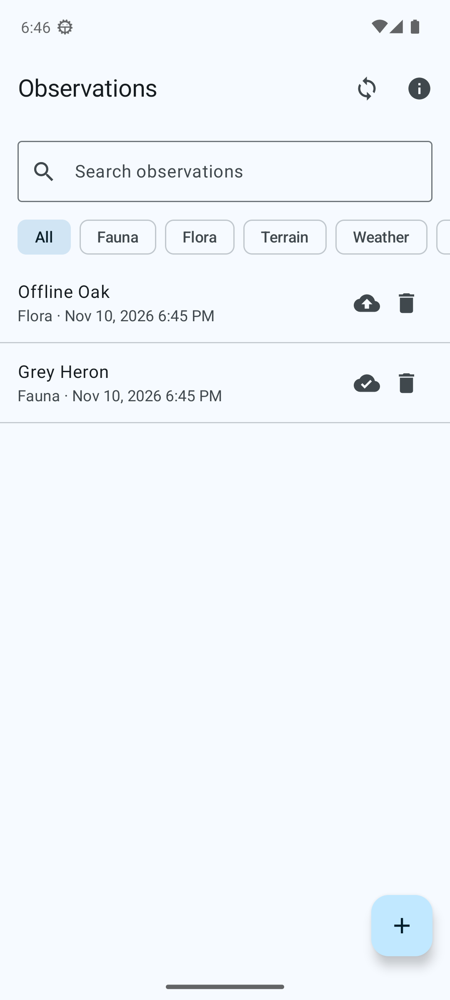
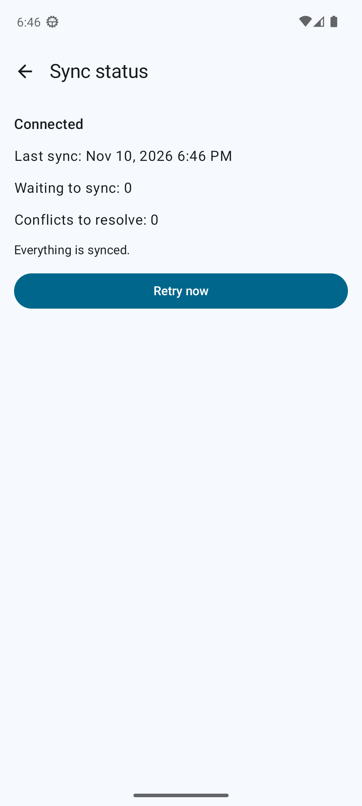

# 📓 Bitácora

**Tu cuaderno de campo, con o sin cobertura** 
*Your field notebook, with or without signal*

  

[Español](#español) · [English](#english)

 &nbsp;  &nbsp; 

## Español

Bitácora es un diario para salir al campo. Apunta lo que ves (un ave, una planta, el estado del terreno o del tiempo) con foto y ubicación, aunque estés en mitad del monte sin una sola raya de cobertura. Cuando vuelves a tener conexión, todo se sincroniza solo.

### ✨ Qué puedes hacer

- 📝 **Apuntar observaciones** con título, notas y categoría: fauna, flora, terreno, tiempo u otra.
- 📷 **Añadir una foto** de la galería a cada observación.
- 📍 **Guardar dónde estabas** con tu ubicación actual, o escribirla a mano si lo prefieres.
- 🔍 **Encontrar cualquier nota** buscando por texto o filtrando por categoría.
- 📶 **Trabajar sin conexión**: todo se guarda en el móvil y se sube cuando vuelve la red.
- 🔄 **Usarla en varios dispositivos**: los cambios hechos en otro móvil aparecen en el tuyo.
- 🤝 **Resolver choques**: si la misma nota se editó en dos sitios, eliges qué versión quedarte.
- ☁️ **Ver el estado de un vistazo**: cada nota indica si ya está subida y una pantalla resume la sincronización.
- 📱 **Móvil y tablet**: en pantallas grandes, la lista y la nota se ven lado a lado.

---

## English

Bitácora is a journal for fieldwork. Write down what you see (a bird, a plant, the state of the ground or the weather) with a photo and your location, even in the middle of nowhere with no signal at all. When you are back online, everything syncs by itself.

### ✨ What you can do

- 📝 **Record observations** with a title, notes and a category: fauna, flora, terrain, weather or other.
- 📷 **Attach a photo** from your gallery to each observation.
- 📍 **Save where you were** with your current location, or type it in yourself.
- 🔍 **Find any note** by searching its text or filtering by category.
- 📶 **Work offline**: everything is stored on the phone and uploaded when the network is back.
- 🔄 **Use it on several devices**: changes made on another phone show up on yours.
- 🤝 **Settle clashes**: if the same note was edited in two places, you choose which version to keep.
- ☁️ **See the status at a glance**: every note shows whether it is uploaded, and one screen sums up the sync.
- 📱 **Phone and tablet**: on large screens the list and the note sit side by side.

---

Parte de mi portfolio de apps Android · Part of my Android app portfolio 
<a href="https://github.com/basd1/bitacora">Bitácora</a> · <a href="https://github.com/basd1/intervalo">Intervalo</a> · <a href="https://github.com/basd1/onda">Onda</a> · <a href="https://github.com/basd1/pixela">Pixela</a> · <a href="https://github.com/basd1/lupa">Lupa</a>

